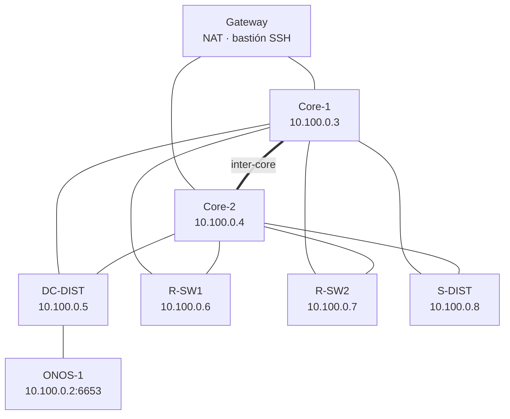
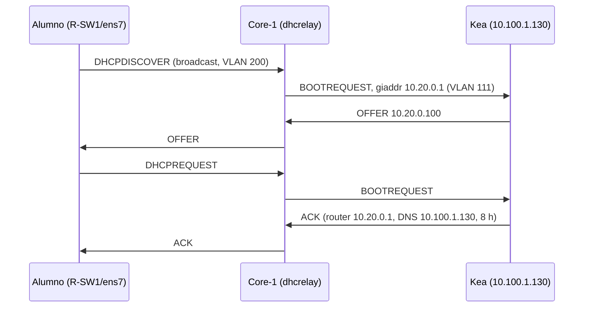

# G5 · Red de campus SDN con control in-band y alta disponibilidad

Proyecto del curso **TEL354 – Redes Definidas por Software** (PUCP, 2026-2), grupo **G05**.

Solución SDN para una red de campus académico desplegada sobre el *private cloud* **VNRT**: un clúster de control **ONOS** de dos nodos, respaldado por **Atomix** (Raft, 3 nodos), gobierna seis switches **Open vSwitch** mediante **OpenFlow 1.3**. El canal de control viaja **in-band** por la propia red de datos, con caminos de respaldo que se activan en menos de un segundo ante la caída de enlaces o de un switch de núcleo.

Requerimientos del grupo: **R1** (control de acceso por rol), **R2** (protección de recursos privilegiados) y **R3** (detección y mitigación de ataques encubiertos en la intranet).

---

## Contenido

- [Arquitectura](#arquitectura)
- [Estado actual](#estado-actual)
- [Estructura del repositorio](#estructura-del-repositorio)
- [Requisitos](#requisitos)
- [Despliegue](#despliegue)
- [Verificación](#verificación)
- [Pruebas de falla y resultados](#pruebas-de-falla-y-resultados)
- [Decisiones técnicas y lecciones](#decisiones-técnicas-y-lecciones)
- [Demo R2 (slice anterior)](#demo-r2-slice-anterior)
- [Hoja de ruta](#hoja-de-ruta)
- [Seguridad del repositorio](#seguridad-del-repositorio)

---

## Arquitectura

### Topología

El campus se abstrae en **15 VMs** repartidas en tres dominios de falla (DF):

| Dominio | Representa | VMs |
|---|---|---|
| **DF1** | Centro de datos | Core-1, DC-DIST, ONOS-1, LDAP/RADIUS, DNS/DHCP, Recursos |
| **DF2** | Edificio R | R-SW1, R-SW2, ONOS-2, IDS, Alumno |
| **DF3** | Edificio S | Core-2, S-DIST, Atomix-3 |
| Borde | Salida a Internet | Gateway (NAT y bastión SSH) |



### Tres redes lógicas

| Red | Medio | Uso |
|---|---|---|
| **Datos** | Enlaces entre switches (`ens4…ens9`) | Tráfico de usuarios y servicios |
| **Control (in-band)** | Los mismos enlaces de datos, por el puerto `LOCAL` de cada `br0` | OpenFlow 1.3 (TCP/6653) y ARP hacia ONOS-1 |
| **Gestión (out-of-band)** | `ens3` en 192.168.0.0/24, aislada de OVS | SSH y Ansible desde el Gateway |

### Direccionamiento de control

| Switch | IP de `br0` | DPID |
|---|---|---|
| Core-1 | 10.100.0.3/28 | `of:0000000000000003` |
| Core-2 | 10.100.0.4/28 | `of:0000000000000004` |
| DC-DIST | 10.100.0.5/28 | `of:0000000000000005` |
| R-SW1 | 10.100.0.6/28 | `of:0000000000000006` |
| R-SW2 | 10.100.0.7/28 | `of:0000000000000007` |
| S-DIST | 10.100.0.8/28 | `of:0000000000000008` |
| **ONOS-1** | **10.100.0.2/28** (`ens4`, vía DC-DIST `ens6`) | — |
| **ONOS-2** | **10.100.0.9/28** (`ens4`, vía R-SW2 `ens6`) | — |

### Cómo arranca el control in-band

1. **Árbol provisional.** Cada switch arranca en `fail_mode=secure` con solo los enlaces del árbol activos (cada switch hacia Core-1, y los cores hacia DC-DIST, que cuelga de ONOS-1). Así no hay bucles ni aprendizaje L2 abierto.
2. **Reglas locales mínimas** (`paper-bridge.py`, prioridad 64500). Solo permiten ARP y TCP/6653 entre el puerto `LOCAL` y ONOS.
3. **Incorporación salto a salto** (app ONOS `org.g05.inband`, prioridad 62500). Cuando un switch hace ARP buscando a ONOS, el vecino ya conectado entrega el ARP por Packet-In. La app calcula el camino sobre los enlaces descubiertos por LLDP e instala el tránsito, y el switch abre su sesión OpenFlow. El procedimiento sigue el esquema de incorporación progresiva de *Sharma et al.*
4. **Redundancia** (`g05-redundancia`, prioridades 64600/64000). Una vez arriba, se activan los enlaces redundantes con BFD y grupos **Fast Failover** que protegen el canal de control sin depender de ONOS.

### Clúster de control

| Nodo | VM | Dominio | Rol |
|---|---|---|---|
| ONOS-1 + Atomix-1 | onos-1 (`192.168.0.16`) | DF1 | Controlador y votante Raft |
| ONOS-2 + Atomix-2 | onos-2 (`192.168.0.17`) | DF2 | Controlador y votante Raft |
| Atomix-3 | atomix-3 (`192.168.0.18`) | DF3 | Solo votante (árbitro) |

- Cada switch tiene **dos controladores** (`tcp:10.100.0.2:6653` y `tcp:10.100.0.9:6653`), los dos alcanzados in-band. ONOS reparte la maestría: uno es `master` y el otro queda en `standby`.
- El estado de la red (reglas, grupos, configuración de apps) vive en **Atomix**. Con 2 de 3 votos hay quórum, así que la caída completa de DF1 deja operativos a ONOS-2, Atomix-2 y Atomix-3.
- La sincronización ONOS↔ONOS (`9876`) y Atomix (`5679`) usa la **red de gestión**. El control de los switches sigue siendo in-band.
- Los caminos ARP/OpenFlow hacia ONOS-2 los instala `g05-redundancia`, con los mismos grupos Fast Failover que protegen a ONOS-1.

### R2: acceso a recursos privilegiados por rol

El rol viaja como VLAN = rol × 100. **R-SW1** aplica la política con el pipeline de 6 tablas de `r2ctl`, programado **por ONOS** (appId `edu.pucp.r2ctl`):

| Tabla | Función |
|---|---|
| T0 | Ingreso: LLDP/EAPOL al controlador, tráfico de usuario a T1, tráfico de red a T5 |
| T1 | Anti-spoofing: puerto + MAC + IP de cada usuario |
| T2 | Mitigación (reservada para R3) |
| T3 | Identidad: MAC → `push_vlan` del rol |
| T4 | Política por rol (58 reglas): recursos permitidos, bloqueo del bloque crítico con meter, bloqueo de la intranet |
| T5 | Salida hacia Core-1 con la VLAN del rol y entrega a cada usuario por MAC |

Core-1 enruta entre las VLAN de rol y los segmentos de servicios (`g02` LDAP/RADIUS, `g11` DNS/DHCP, `srv` Recursos). Su firewall (`g05-core1-router.nft`) descarta todo intento de llegar a la gestión, al plano de control, al propio Core-1 o a otro usuario.

| Rol | VLAN | Subred | Recursos permitidos |
|---|---|---|---|
| 1 invitado | 100 | 10.10.0.0/24 | DNS, Mesa de ayuda, Internet |
| 2 alumno | 200 | 10.20.0.0/24 | + Portal |
| 3 docente | 300 | 10.30.0.0/24 | + Notas, Investigación, Laboratorios |
| 4 administrativo | 400 | 10.40.0.0/24 | Unidad administrativa, Portal, DNS, Mesa de ayuda, Internet |
| 5 admin | 500 | 10.50.0.0/24 | Todo (salvo la infraestructura de control y gestión) |
| 9 cuarentena | 900 | 10.90.0.0/24 | DNS y Mesa de ayuda, sin Internet |

### Servicios: DHCP de alumnos

Cada segmento de servicio es un circuito L2 transportado con una VLAN entre switches y entregado sin etiqueta en sus extremos (`g05-servicios`, prioridad 50000):

| Segmento | Extremo A | Extremo B | Direccionamiento |
|---|---|---|---|
| VLAN 200 · alumnos | R-SW1 `ens7` (Alumno) | Core-1, puerto interno `v200` | `10.20.0.0/24`, gateway `10.20.0.1` |
| VLAN 111 · G11 | Core-1, puerto interno `g11` | DC-DIST `ens8` (DNS/DHCP) | `10.100.1.128/28`, router `.129`, servidor `.130` |



Core-1 no reenvía IPv4 entre segmentos. En esta fase, R-SW1 solo deja pasar del Alumno **ARP, DHCP e ICMP a su gateway**. El acceso a los servicios institucionales lo abrirán R1 (autenticación) y R2 (política por rol).

---

## Estado actual

| Componente | Estado |
|---|---|
| Clúster ONOS-1 + ONOS-2 sobre Atomix (3 nodos) | ✅ Operativo; ONOS-2 asume los 6 switches en ~10 s si cae DF1 |
| Bootstrap in-band de los 6 switches | ✅ 6/6 DPID disponibles, evidencia sin diferencias |
| Redundancia del canal de control (BFD + Fast Failover) | ✅ Probada ante caídas de enlace y de Core-1 |
| DHCP de alumnos (VLAN 200, relay en Core-1, Kea) | ✅ Concesión completa al Alumno (`10.20.0.100/24`) |
| **R2** sobre la topología final (roles estáticos) | ✅ 216 pruebas, 0 discrepancias; 142/142 accesos no autorizados bloqueados |
| R1 (802.1X dinámico) y R3 | 🔜 Pendiente |

---

## Estructura del repositorio

```
.
├── infraestructura/              Proyecto Ansible del slice final (se ejecuta desde el Gateway)
│   ├── inventario.yml            Hosts, IPs de gestión e IPs de br0
│   ├── puertos-ejemplo.yml       Mapa de interfaces/MAC de los enlaces del slice
│   ├── iniciar-onos.sh           Lanzador (perfiles ONOS, Articulo, Evidencia)
│   ├── Iniciar-ONOS.ps1          Lanzador equivalente desde Windows
│   ├── onos.yml                  Levanta ONOS-1 y prepara su política de reglas
│   ├── paper.yml                 Bootstrap in-band completo (incluye los dos siguientes)
│   ├── paper-bridges.yml         Crea br0, puertos del árbol y reglas LOCAL
│   ├── local-ip.yml              IP estática del puerto LOCAL de cada br0
│   ├── evidencia-arbol.yml       Genera evidencia JSON del árbol (OVS vs ONOS)
│   ├── redundancia.yml           Instala BFD, grupos Fast Failover y servicios
│   ├── servicios.yml             Segmentos VLAN, Core-1 router, relay, Kea y servidores
│   ├── inventario-servidores.yml Grupo servidores (recursos, ldap-radius, dns-dhcp)
│   ├── cluster.yml               Atomix (3 nodos), ONOS-1/ONOS-2 en clúster y 2.º controlador
│   ├── inventario-cluster.yml    Grupo atomix (onos-1, onos-2, atomix-3)
│   ├── dhcp.yml                  Kea DHCPv4 para alumnos (lo importa servicios.yml)
│   ├── dns-gestion.yml           DNS de gestión para las VMs sin salida
│   ├── inspeccionar.yml          Inventario de NIC/MAC de cada VM
│   ├── files/
│   │   ├── paper-bridge.py       Preparación de br0 y reglas LOCAL en cada switch
│   │   ├── g05-redundancia.py    Módulo de redundancia (ports | apply | status | remove)
│   │   ├── g05-servicios.py      Segmentos de servicio (apply | status | remove)
│   │   ├── g05-core1-router.nft  Firewall de Core-1 como router
│   │   ├── servidores.sh, svc.py IPs por recurso, ruta de vuelta y servicios de prueba
│   │   ├── cluster/              Plantillas Atomix/ONOS y scripts de arranque y configuración
│   │   └── evidencia_arbol.py    Muestra del estado de cada switch
│   ├── paper-app/                App ONOS org.g05.inband (Java, Maven) y su OAR
│   ├── templates/                Plantilla del perfil estático anterior
│   └── evidencia/                Evidencia JSON generada en el slice
├── pruebas/
│   ├── prueba-fallas.sh          Pruebas de caída de enlaces y de Core-1
│   └── prueba-caida-df1.sh       Caída de ONOS-1 + Atomix-1 y toma de control de ONOS-2
├── politica/                     R2 sobre el slice final
│   ├── r2ctl.py                  Compilador y despliegue de la política por ONOS (modo enrutado)
│   ├── policy.yaml               Recursos G01–G12 y permisos por rol
│   ├── topology.yaml             R-SW1, usuarios de prueba y parámetros de verificación
│   └── usuarios-ns.sh            Un namespace por rol en la VM Alumno (macvlan + IP fija)
└── r2-demo/                      Demo R2/R1 del parcial (slice anterior de 4 switches)
    ├── ansible/                  Controller, switches, endpoints, LDAP/RADIUS, 802.1X
    └── r2/                       r2ctl: despliegue declarativo de la política R2
```

---

## Requisitos

- Acceso al slice VNRT por VPN y canales SSH hacia el Gateway (`10.20.12.7`).
- En el Gateway: `ansible-core` y `sshpass` (el lanzador los instala si faltan).
- En los switches: Ubuntu 24.04 con Open vSwitch 3.3.
- En ONOS-1: Docker con la imagen `onosproject/onos:2.7.0`.
- Para recompilar la app: JDK 11 y Maven (`cd paper-app && mvn clean package`). El repositorio incluye el OAR compilado.

---

## Despliegue

Todos los comandos se ejecutan **en el Gateway**, dentro de la carpeta `infraestructura/`. Las contraseñas (SSH, sudo y REST de ONOS) se piden de forma interactiva y no se guardan.

```bash
# 1. Controlador + bootstrap in-band + evidencia
bash iniciar-onos.sh Articulo

# 2. Solo regenerar la evidencia del árbol
bash iniciar-onos.sh Evidencia

# 3. Redundancia del canal de control
ansible-playbook -i inventario.yml redundancia.yml -k -K

# 4. Servicios: segmentos VLAN, Core-1 router, relay DHCP, Kea y servidores
ansible-playbook -i inventario.yml -i inventario-servidores.yml servicios.yml -k -K

# 5. Clúster de control (Atomix x3, ONOS-1 + ONOS-2, segundo controlador en los switches)
ansible-playbook -i inventario.yml -i inventario-cluster.yml cluster.yml -k -K
```

> **Orden crítico al (re)crear ONOS en clúster:** el almacén nuevo empieza vacío. `onos-configurar.sh` activa `allowExtraneousRules` y `allowExtraneousGroups`, instala la app in-band y **recién después** activa OpenFlow. Si los switches se reconectan antes, ONOS borra las reglas de control locales y se pierde el in-band.
>
> `onos.yml` corresponde a la fase de un solo nodo (exige un único nodo en el clúster). Tras `cluster.yml` ya no se usa.

> **Sin salida a Internet:** en el slice solo ONOS-1 tiene salida, por NAT del Gateway. Para instalar `kea-dhcp4-server` (DNS/DHCP) e `isc-dhcp-relay` (Core-1) se descargan los `.deb` en ONOS-1 con `apt-get download` y se instalan en cada VM con `dpkg -i`.

El módulo de redundancia también se opera directamente en cada switch:

```bash
sudo g05-redundancia ports    # activa los enlaces entre switches con BFD (100 ms)
sudo g05-redundancia apply    # instala grupos FF y reglas (solo si hay diferencias)
sudo g05-redundancia status   # grupos, contadores por bucket y estado BFD
sudo g05-redundancia remove   # retira grupos, reglas y BFD
```

> **Requisito en ONOS:** el módulo instala grupos fuera del controlador, así que `redundancia.yml` activa `allowExtraneousGroups=true` en `DistributedGroupStore`. Es el equivalente, para grupos, de `allowExtraneousRules`, que el bootstrap ya usa.

---

## Verificación

```bash
# ONOS (en ONOS-1, con ~/.netrc)
curl -s -n http://127.0.0.1:8181/onos/v1/devices     # 6 dispositivos disponibles
curl -s -n http://127.0.0.1:8181/onos/v1/links       # 18 enlaces (9 bidireccionales)

# En un switch
sudo ovs-vsctl list Controller                       # is_connected=true
sudo ovs-ofctl -O OpenFlow13 dump-flows br0          # 64600/64500 LOCAL, 64000 respaldo, 62500 app
sudo ovs-ofctl -O OpenFlow13 dump-group-stats br0    # paquetes por bucket (primario / respaldo)
sudo ovs-vsctl get Interface ens4 bfd_status         # state=up, forwarding=true
```

| Prioridad | Cookie | Origen | Función |
|---|---|---|---|
| 64600 | `0x473500000002` | `g05-redundancia` | Salida de `LOCAL` hacia ONOS por grupo Fast Failover |
| 64500 | `0x473500000001` | `paper-bridge.py` | ARP/TCP 6653 entre `LOCAL` y ONOS (árbol) |
| 64000 | `0x473500000002` | `g05-redundancia` | Tránsito de control con respaldo |
| 62500 | app `org.g05.inband` | ONOS | Tránsito calculado en el bootstrap |
| 50000 | `0x473500000003` | `g05-servicios` | Segmentos VLAN 200 (alumnos) y 111 (G11) |

```bash
# DHCP (en Alumno, Core-1 y DNS/DHCP)
sudo networkctl renew ens4 && ip -4 -br addr show ens4      # 10.20.0.100/24
sudo journalctl -u g05-dhcrelay | grep Forwarded            # BOOTREQUEST / BOOTREPLY
sudo tail /var/lib/kea/kea-leases4.csv                      # concesión registrada
```

---

## R2 desde el Mac

```bash
cd politica
python3 r2ctl.py validate            # 115 reglas en R-SW1 (58 en la tabla 4)
python3 r2ctl.py apply               # instala por ONOS lo que falta y retira lo que sobra
python3 r2ctl.py verify              # matriz con el rol actual de cada usuario
python3 r2ctl.py verify --roles all  # u-cic recorre los 6 roles
python3 r2ctl.py stats               # ocupación de tablas y contadores de la tabla 4
```

Requiere `pyyaml` y los canales SSH a ONOS-1 (5806) y a Alumno (5813). En Alumno, `g05-usuarios` crea los namespaces `u-inv`, `u-alu`, `u-doc`, `u-adm`, `u-net` y `u-cic`.

**Resultados (Fase A):**

| Métrica | Valor |
|---|---|
| Pruebas por matriz (6 usuarios × 36 destinos) | 216 |
| Discrepancias contra la política | 0 |
| Precisión en la restricción | 142/142 intentos no autorizados bloqueados (100 %) |
| Reglas en R-SW1 (todas las apps) | 134 (115 de R2) |
| `ovs-vswitchd` en R-SW1 | 4 % de CPU, 50 MB de RSS |
| Aislamiento de infraestructura | El rol admin no alcanza gestión, ONOS-1/2, Core-1 ni otros usuarios |

G01 (ONOS) queda fuera de la matriz: el plano de control in-band no acepta tráfico de usuarios, solo se administra por la red de gestión.

## Pruebas de falla y resultados

`pruebas/prueba-fallas.sh` apaga interfaces con `ip link`, espera 15 s, mide y restaura. El indicador es `sec_since_connect` de cada sesión OpenFlow: si sigue creciendo durante la falla, la sesión **nunca se cortó**.

| Prueba | Resultado | Respaldo usado |
|---|---|---|
| T1 · cae Core-1 ↔ R-SW1 | Ninguna sesión se corta | R-SW1 sube por Core-2 |
| T2 · cae Core-1 ↔ DC-DIST | Ninguna sesión se corta | Core-1 sale por el enlace inter-core |
| T3 · cae Core-2 ↔ DC-DIST | Ninguna sesión se corta | DC-DIST alcanza Core-2 vía Core-1 |
| T4 · cae Core-1 completo | Los otros 5 switches siguen conectados | Las hojas suben por Core-2 |

Al restaurar Core-1, su sesión se restablece sola en ~10 s. La detección con BFD (`min_rx = min_tx = 100 ms`) tarda menos de 0,5 s, por debajo del margen de *keepalive* de OpenFlow.

**Caída de DF1 en el plano de control** (`pruebas/prueba-caida-df1.sh`): se detienen ONOS-1 y Atomix-1.

| Tiempo desde la caída | Switches con ONOS-2 como master |
|---|---|
| 3–6 s | 0/6 |
| 8 s | 2/6 |
| 11 s | 6/6 |

Atomix siguió con 2 de 3 votos sin elecciones nuevas, porque los líderes de las particiones estaban en Atomix-2 y Atomix-3. Al restaurar, ONOS-1 vuelve al clúster con la configuración intacta, que está guardada en Atomix. La medición tiene una resolución de ~3 s, porque cada vuelta consulta los 6 switches por SSH.

**Pendiente de probar:** la caída física de DC-DIST, que en la topología es el único camino in-band hacia ONOS-1.

---

## Decisiones técnicas y lecciones

**El VNRT no propaga la caída de portadora.** Si se apaga un extremo de un enlace, el otro sigue en `LIVE`. Un grupo Fast Failover basado solo en el estado del puerto dejaría un lado enviando a un enlace muerto. Por eso la vida de cada puerto la decide **BFD**, que sí detecta la caída en ambos extremos.

**Protección local antes que recálculo central.** Con control in-band, una caída puede dejar a ONOS inalcanzable justo cuando haría falta. Los respaldos se instalan de antemano en los switches y conmutan sin intervención del controlador.

**Errores corregidos en el bootstrap original:**

| # | Síntoma | Causa | Corrección |
|---|---|---|---|
| 1 | `ovs-vsctl --dry-run` muere por SIGALRM | Sin `--no-wait`, espera una confirmación de `ovs-vswitchd` que un ensayo nunca produce | `--no-wait` en el ensayo |
| 2 | La verificación de puertos falla con puertos correctos | En OF 1.3 `dump-ports-desc` ignora el filtro de puerto y se leía siempre el puerto 1 | Se busca el bloque del puerto correcto |
| 3 | `local-ip.yml` falla en todos los switches | `ovs-vsctl iface-to-br br0` no reconoce el puerto interno del propio bridge | Se elimina la comprobación (la de tipo `internal` basta) |
| 4 | Las reglas LOCAL se reinstalan cada 10 s y reinician sus contadores | `dl_vlan=0xffff` se almacena como `vlan_tci=0x0000/0x1fff` y la comparación textual nunca coincide | Se escribe directamente en el formato de OVS |

**Otros hallazgos del slice:**
- Las VMs no tienen salida a Internet (solo ONOS-1, por NAT del Gateway).
- Las imágenes Docker se copian entre VMs con `docker save | ssh | docker load`, y los paquetes `.deb` (Docker, Kea, relay) se bajan en ONOS-1 y se instalan con `dpkg -i`.
- ONOS-1 tiene un disco de 5,9 GB: con las imágenes de ONOS (1,45 GB) y Atomix (1 GB) queda sin margen. Hay que vigilar `df -h /` antes de cada cambio.
- AppArmor impide que `kea-dhcp4 -t` lea archivos fuera de `/etc/kea`, así que la configuración se valida ya instalada.
- `paper-bridge.py` rechazaba cualquier puerto no físico en `br0`. Ahora acepta los puertos internos marcados con `external_ids:g05-l3=true`.
- ONOS-1 recibió un disco de 5,9 GB, no los 10 GB solicitados.
- DC-DIST, R-SW1, R-SW2 y S-DIST tienen ~1 GB de RAM real.

---

## Demo R2 (slice anterior)

`r2-demo/` contiene la demo del parcial sobre un slice de 4 switches. Incluye:
- `r2ctl`, un despliegue declarativo de la política R2 sobre ONOS por REST, con un pipeline de 6 tablas: ingreso, anti-spoofing, mitigación, identidad, política y reenvío.
- R1 con 802.1X (EAP-TLS) mediante la app AAA de ONOS, FreeRADIUS y OpenLDAP.

Las direcciones e inventarios corresponden a ese slice, no al final.

```bash
cd r2-demo
pip install pyyaml
python3 r2/r2ctl.py validate   # también: plan, apply, verify, stats, rol, clear
```

---

## Hoja de ruta

1. **R1 (Fase B):** 802.1X con FreeRADIUS + OpenLDAP y la app AAA de ONOS; `identity` une sesión, rol e IP (con Kea) y reemplaza las asignaciones estáticas. Incluye la ventana DHCP por rol (hoy el Alumno sin namespace queda sin DHCP, porque el puerto lo gobierna R2).
2. **R3:** Suricata con espejo en R-SW1 y mitigación por la API REST de ONOS.
3. **Prueba física de DF1:** apagar DC-DIST y comprobar que el control sigue por ONOS-2.

---

## Seguridad del repositorio

- No se versionan contraseñas, secretos RADIUS, claves privadas ni certificados. Ansible los genera en `credentials/`, que está excluida en `.gitignore`.
- Las credenciales de SSH, sudo y REST de ONOS se solicitan en cada ejecución (`-k -K` y `vars_prompt`).
- Las direcciones del repositorio son privadas del laboratorio VNRT.
