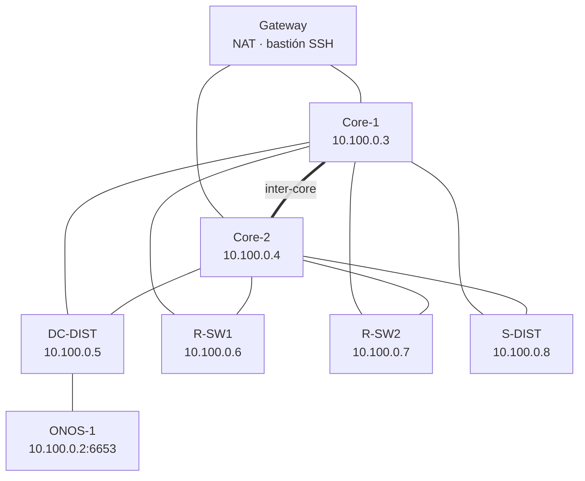
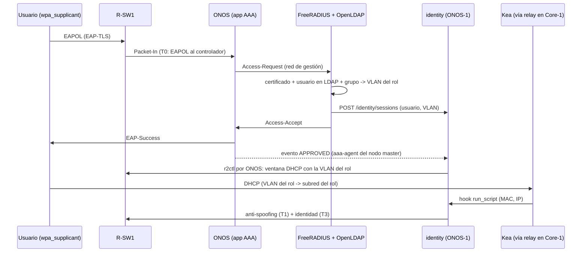
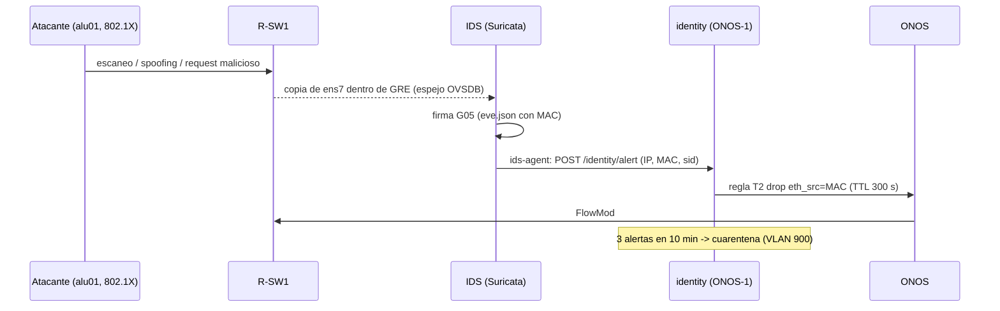
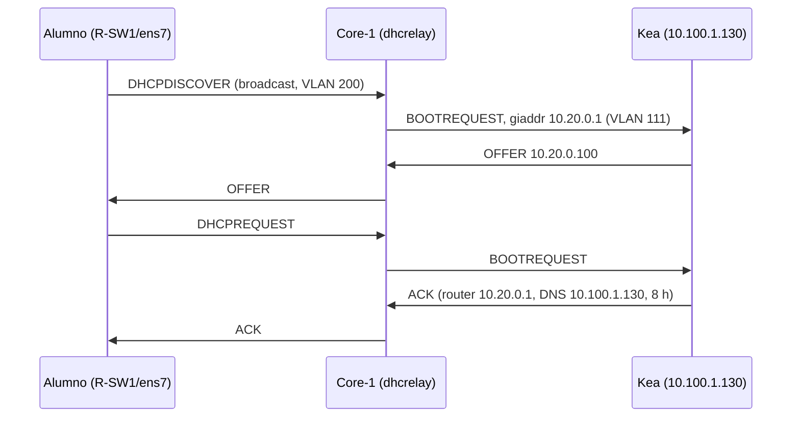

# G5 · Red de campus SDN con control in-band y alta disponibilidad

Proyecto del curso **TEL354 – Redes Definidas por Software** (PUCP, 2026-2), grupo **G05**.

Solución SDN para una red de campus académico desplegada sobre el *private cloud* **VNRT**: un clúster de control **ONOS** de dos nodos, respaldado por **Atomix** (Raft, 3 nodos), gobierna seis switches **Open vSwitch** mediante **OpenFlow 1.3**. El canal de control viaja **in-band** por la propia red de datos, con caminos de respaldo que se activan en menos de un segundo ante la caída de enlaces o de un switch de núcleo.

Requerimientos del grupo: **R1** (control de acceso por rol), **R2** (protección de recursos privilegiados) y **R3** (detección y mitigación de ataques encubiertos en la intranet). Como grupo de 4 se suma **R4** (detección de DDoS por consumo de ancho de banda y mitigación por fuente).

---

## Contenido

- [Arquitectura](#arquitectura)
- [Estado actual](#estado-actual)
- [Estructura del repositorio](#estructura-del-repositorio)
- [Requisitos](#requisitos)
- [Despliegue](#despliegue)
- [Verificación](#verificación)
- [Pruebas unitarias](#pruebas-unitarias)
- [Pruebas de falla y resultados](#pruebas-de-falla-y-resultados)
- [Decisiones técnicas y lecciones](#decisiones-técnicas-y-lecciones)
- [Demo R2 (slice anterior)](#demo-r2-slice-anterior)
- [Hoja de ruta](#hoja-de-ruta)
- [Seguridad del repositorio](#seguridad-del-repositorio)

---

## Arquitectura

### Topología

El campus se abstrae en **15 VMs** repartidas en tres dominios de falla (DF):

| Dominio | Representa | VMs |
|---|---|---|
| **DF1** | Centro de datos | Core-1, DC-DIST, ONOS-1, LDAP/RADIUS, DNS/DHCP, Recursos |
| **DF2** | Edificio R | R-SW1, R-SW2, ONOS-2, IDS, Alumno |
| **DF3** | Edificio S | Core-2, S-DIST, Atomix-3 |
| Borde | Salida a Internet | Gateway (NAT y bastión SSH) |



### Tres redes lógicas

| Red | Medio | Uso |
|---|---|---|
| **Datos** | Enlaces entre switches (`ens4…ens9`) | Tráfico de usuarios y servicios |
| **Control (in-band)** | Los mismos enlaces de datos, por el puerto `LOCAL` de cada `br0` | OpenFlow 1.3 (TCP/6653) y ARP hacia ONOS-1 |
| **Gestión (out-of-band)** | `ens3` en 192.168.0.0/24, aislada de OVS | SSH y Ansible desde el Gateway |

### Direccionamiento de control

| Switch | IP de `br0` | DPID |
|---|---|---|
| Core-1 | 10.100.0.3/28 | `of:0000000000000003` |
| Core-2 | 10.100.0.4/28 | `of:0000000000000004` |
| DC-DIST | 10.100.0.5/28 | `of:0000000000000005` |
| R-SW1 | 10.100.0.6/28 | `of:0000000000000006` |
| R-SW2 | 10.100.0.7/28 | `of:0000000000000007` |
| S-DIST | 10.100.0.8/28 | `of:0000000000000008` |
| **ONOS-1** | **10.100.0.2/28** (`ens4`, vía DC-DIST `ens6`) | — |
| **ONOS-2** | **10.100.0.9/28** (`ens4`, vía R-SW2 `ens6`) | — |

### Cómo arranca el control in-band

1. **Árbol provisional.** Cada switch arranca en `fail_mode=secure` con solo los enlaces del árbol activos (cada switch hacia Core-1, y los cores hacia DC-DIST, que cuelga de ONOS-1). Así no hay bucles ni aprendizaje L2 abierto.
2. **Reglas locales mínimas** (`paper-bridge.py`, prioridad 64500). Solo permiten ARP y TCP/6653 entre el puerto `LOCAL` y ONOS.
3. **Incorporación salto a salto** (app ONOS `org.g05.inband`, prioridad 62500). Cuando un switch hace ARP buscando a ONOS, el vecino ya conectado entrega el ARP por Packet-In. La app calcula el camino sobre los enlaces descubiertos por LLDP e instala el tránsito, y el switch abre su sesión OpenFlow. El procedimiento sigue el esquema de incorporación progresiva de *Sharma et al.*
4. **Redundancia** (`g05-redundancia`, prioridades 64600/64000). Una vez arriba, se activan los enlaces redundantes con BFD y grupos **Fast Failover** que protegen el canal de control sin depender de ONOS.

### Clúster de control

| Nodo | VM | Dominio | Rol |
|---|---|---|---|
| ONOS-1 + Atomix-1 | onos-1 (`192.168.0.16`) | DF1 | Controlador y votante Raft |
| ONOS-2 + Atomix-2 | onos-2 (`192.168.0.17`) | DF2 | Controlador y votante Raft |
| Atomix-3 | atomix-3 (`192.168.0.18`) | DF3 | Solo votante (árbitro) |

- Cada switch tiene **dos controladores** (`tcp:10.100.0.2:6653` y `tcp:10.100.0.9:6653`), los dos alcanzados in-band. ONOS reparte la maestría: uno es `master` y el otro queda en `standby`.
- El estado de la red (reglas, grupos, configuración de apps) vive en **Atomix**. Con 2 de 3 votos hay quórum, así que la caída completa de DF1 deja operativos a ONOS-2, Atomix-2 y Atomix-3.
- La sincronización ONOS↔ONOS (`9876`) y Atomix (`5679`) usa la **red de gestión**. El control de los switches sigue siendo in-band.
- Los caminos ARP/OpenFlow hacia ONOS-2 los instala `g05-redundancia`, con los mismos grupos Fast Failover que protegen a ONOS-1.

### R2: acceso a recursos privilegiados por rol

El rol viaja como VLAN = rol × 100. **R-SW1** aplica la política con el pipeline de 6 tablas de `r2ctl`, programado **por ONOS** (appId `edu.pucp.r2ctl`):

| Tabla | Función |
|---|---|
| T0 | Ingreso: LLDP/EAPOL al controlador, tráfico de usuario a T1, tráfico de red a T5 |
| T1 | Anti-spoofing: puerto + MAC + IP de cada usuario |
| T2 | Mitigación de R3: descarte de la MAC de un atacante detectado |
| T3 | Identidad: MAC → `push_vlan` del rol |
| T4 | Política por rol (58 reglas): recursos permitidos, bloqueo del bloque crítico con meter, bloqueo de la intranet |
| T5 | Salida hacia Core-1 con la VLAN del rol y entrega a cada usuario por MAC |

Core-1 enruta entre las VLAN de rol y los segmentos de servicios (`g02` LDAP/RADIUS, `g11` DNS/DHCP, `srv` Recursos). Su firewall (`g05-core1-router.nft`) descarta todo intento de llegar a la gestión, al plano de control, al propio Core-1 o a otro usuario.

**Decisión y precedencia:**
- **`r2ctl.evaluate_access(pol, rol, recurso[, proto, puerto])`** devuelve `('PERMIT'|'DENY', motivo)` desde `policy.yaml`. Todo rol o recurso no registrado se deniega por defecto.
- **`deniega: [G..]`** en un rol compila a reglas de descarte en T4 con prioridad 29950, por encima de cualquier permiso del rol, incluido el permiso total del admin (29900). Cuando PERMIT y DENY coinciden sobre el mismo tráfico, gana DENY.
- **Cambiar la política:** se edita `policy.yaml` y se aplica con `r2ctl apply` (o lo reconcilia identity).

**Registro de accesos:** los accesos permitidos también se registran, como `ACCESO_PERMITIDO` con usuario, rol, MAC y destino. Vienen de las firmas sid 25xxxxx, generadas también desde `policy.yaml`, y se consultan con `GET /identity/accesos`.

**Trazabilidad de intentos:**
- **Qué se registra:** cada intento contra un recurso que el rol no tiene permitido, con usuario 802.1X, rol, MAC, destino y motivo. Va a `INTENTO_DENEGADO` en el registro de seguridad (`/var/log/g05/incidentes.jsonl`) y se resume por usuario y destino en `GET /identity/intentos`.
- **Por qué con el IDS:** atribuirlo con contadores del switch costaría una regla por usuario y recurso. En cambio, el switch descarta el intento y el IDS, que ya ve el puerto de usuarios por el espejo de R3, lo reporta.
- **Firmas:** las genera `r2ctl ids-reglas` desde `policy.yaml` (90 firmas, sid 2xxxxxx), así que la política sigue siendo la única fuente de verdad. Cubren:
  - recursos no permitidos;
  - puertos no ofrecidos de los recursos permitidos;
  - la gestión;
  - Core-1;
  - otras subredes de usuarios;
  - Internet, para la cuarentena.
- **Límite:** una por par origen-destino cada 60 s.
- **Sin bloqueo:** `identity` reconoce estas firmas por su sid, así que solo las registra y no bloquea.

| Rol | VLAN | Subred | Recursos permitidos |
|---|---|---|---|
| 1 invitado | 100 | 10.10.0.0/24 | DNS, Mesa de ayuda, Internet |
| 2 alumno | 200 | 10.20.0.0/24 | + Portal |
| 3 docente | 300 | 10.30.0.0/24 | + Notas, Investigación, Laboratorios |
| 4 administrativo | 400 | 10.40.0.0/24 | Unidad administrativa, Portal, DNS, Mesa de ayuda, Internet |
| 5 admin | 500 | 10.50.0.0/24 | Todo (salvo la infraestructura de control y gestión) |
| 9 cuarentena | 900 | 10.90.0.0/24 | DNS y Mesa de ayuda, sin Internet |

### R1: autenticación 802.1X y rol dinámico



| Componente | Dónde | Función |
|---|---|---|
| App AAA `org.opencord.aaa` 2.11.2 (+ SADIS 5.12.3) | Clúster ONOS | Autenticador 802.1X: recibe el EAPOL por Packet-In y habla RADIUS con FreeRADIUS |
| FreeRADIUS 3.2 + OpenLDAP 2.6 | ldap-radius | EAP-TLS con la CA del campus. El grupo de LDAP fija el rol (`Tunnel-Private-Group-Id` = VLAN). Usuario sin grupo: rechazado. `ppolicy` bloquea tras 5 fallos. Exige `Message-Authenticator` (Blast-RADIUS) |
| `identity` (`politica/identity.py`) | ONOS-1, `g05-identity.service` | Une la sesión 802.1X, el rol y la IP, y reconcilia las reglas de R2 por ONOS |
| `aaa-agent` (`politica/aaa-agent.py`) | ONOS-1 y ONOS-2 | Reenvía a `identity` los eventos AAA del log del nodo master (STARTED, APPROVED, FAILURE, IDLE) |
| Kea + hook `run_script` | dns-dhcp | Una subred por rol, según la interfaz del relay. Cada concesión se avisa a `identity` |
| `g05-r1` (`politica/g05-r1.sh`) | Alumno | Login, logout y DHCP 802.1X por namespace |

Las claves y certificados de prueba se generan en la VM ldap-radius (`/root/g05-r1`, solo root) y **no se versionan**.

**Limitaciones encontradas:**
- La app AAA mantiene **un supplicant autenticado por puerto**, como un puerto de acceso real. Los usuarios de prueba comparten el único puerto de la VM Alumno, así que las pruebas usan un supplicant a la vez.
- La REST de AAA **no refleja el EAPOL-Logoff**. `identity` lo detecta con el evento IDLE del log y el contador EAPOL del puerto.
- El VNRT descarta la MAC de grupo de EAPOL. `g05-r1` reescribe el EAPOL saliente a broadcast con `tc`. El supplicant puede no ver el EAP-Failure, pero sin sesión en `identity` no hay DHCP ni reglas.
- Con EAP-TLS no hay contraseña, así que el bloqueo de `ppolicy` solo aplica a métodos que hacen `bind` contra LDAP.

**Controles de la credencial:**
- **CN = identidad:** `check_cert_cn` impide presentar un certificado propio con la identidad de otro.
- **Revocación por CRL:** `check_crl`, con `sudo g05-revocar <cert.pem>` en ldap-radius.
- **Registro:** FreeRADIUS guarda cada intento en `radius.log` (`Login OK` / `Login incorrect (motivo)`). identity guarda los rechazos (`SESION_RECHAZADA`, `DHCP_SIN_SESION`, `ACCESO_DENEGADO`) en `/var/log/g05/incidentes.jsonl`.
- **Rechazo uniforme:** que la cuenta exista y no esté bloqueada se comprueba en `post-auth`, después del EAP. `Post-Auth-Type REJECT` incluye `eap`. Así un usuario inexistente, una inyección (`' OR '1'='1`, `*`) o un certificado inválido reciben el mismo Access-Reject (EAP-Failure + Message-Authenticator), y no se pueden enumerar cuentas. El motivo real solo queda en `radius.log`.
- **Bloqueo por intentos fallidos (R1-03):**
  - **Política:** 5 rechazos seguidos en 15 min bloquean la cuenta 15 min, la misma de la `ppolicy` de LDAP.
  - **Cómo se registra el rechazo:** con EAP-TLS no hay contraseña, así que FreeRADIUS escribe cada respuesta en `g05-intentos.log` (`linelog`). El usuario va en hexadecimal, para que un nombre con saltos de línea no fabrique líneas.
  - **Cómo se bloquea:** `g05-bloqueo` (en ldap-radius) aplica la política y escribe `pwdAccountLockedTime` en LDAP. Con eso la cuenta se rechaza incluso con su certificado.
  - **Desbloqueo:** el servicio quita el bloqueo al vencer. Un acceso correcto reinicia el contador.
  - **Registro:** cada fallo, bloqueo y desbloqueo se avisa a identity (`INTENTO_FALLIDO`, `CUENTA_BLOQUEADA`, `CUENTA_DESBLOQUEADA`).
  - **Comandos:** `sudo g05-bloqueo estado` y `sudo g05-bloqueo desbloquear <usuario>`, este último con el servicio detenido.
- **Multirol:** un usuario puede estar en varios grupos de LDAP. Gana el de mayor privilegio (admin > administrativo > docente > alumno). Ejemplo: `multi01`, docente y admin, recibe la VLAN 500.

### R3: detección y mitigación de ataques encubiertos



| Pieza | Dónde | Qué hace |
|---|---|---|
| Espejo `g05-ids` (`files/ids/g05-espejo.sh`) | R-SW1, `g05-espejo.service` | Copia ens7 (usuarios) en ambos sentidos a un puerto GRE (`key 4735`) hacia 192.168.0.22. Es un espejo de OVSDB y no toca el pipeline de OpenFlow |
| Suricata 7 (`files/ids/ids-setup.sh`) | VM IDS, interfaz `ids-gre` (gretap) | Solo las firmas del G05 (`files/ids/g05.rules`), EVE con MAC de origen |
| `ids-agent` (`files/ids/ids-agent.py`) | VM IDS | Sigue `eve.json` y envía cada alerta a `identity` (deduplicada 5 s) |
| Sensor de spoofing | `identity` + regla T1 prioridad 45000 por usuario | Cuenta los paquetes con IP de origen ajena que T1 ya descarta. Si suman 3 o más en una ventana de 10 s (dos lecturas de ONOS), bloquea la MAC sin depender del IDS |
| Registro de incidentes | ONOS-1, `/var/log/g05/incidentes.jsonl` | Alerta → bloqueo → regla aplicada → fin. Se consulta con `GET /identity/incidents` o `pruebas/incidentes.sh` |

**Firmas:** escaneo de puertos (SYN a puertos no ofrecidos), barrido ICMP, escaneo TCP de red, IP spoofing, inyección SQL, XSS, path traversal (sobre la URI cruda), herramientas de ataque por User-Agent, ráfaga de requests HTTP (bot) e inundación de SYN. Los umbrales se calibraron con la matriz de R2 y con tráfico legítimo, para no dar falsos positivos.

**Mitigación:** se bloquea la **MAC autenticada** del atacante, no su IP, que puede ser falsa. El bloqueo afecta solo a ese usuario; los demás usuarios del mismo puerto no lo notan. Vence a los 300 s, o antes con `DELETE /identity/block/<mac>`. La reincidencia (3 alertas en 10 min) lo pasa a cuarentena.

**Limitaciones del VNRT:** el enlace directo R-SW1/ens6 → IDS solo entrega tramas dirigidas a la MAC del IDS (y broadcast): el espejo unicast se perdía. Por eso el espejo viaja en GRE por la red de gestión, como un ERSPAN.

### R4: mitigación de DDoS por consumo de ancho de banda

R3 detecta ataques con firma (escaneos, SYN flood, ráfagas HTTP). R4 detecta **volumen**: una inundación sin firma (por ejemplo, ACK o UDP con carga útil) que satura un servidor o el enlace compartido.

| Pieza | Qué hace |
|---|---|
| Monitor (`watch_ddos` en `identity`) | Cada 2,5 s lee los contadores de ONOS: lo que envía cada usuario (regla T3), lo que recibe (reglas T5 de entrega) y lo que llega a cada recurso (reglas T4 que lo permiten) |
| Detector (`politica/ddos.py`) | Sin E/S, probado en unitarias |
| Mitigación | Un **meter propio por fuente** (2 Mbit/s, `DROP`) en una regla T2 (prioridad 39000) delante de su identidad. No se bloquea, se limita: la política de su rol sigue igual y el resto de usuarios no se toca. Un bloqueo de R3 tiene prioridad sobre el límite |
| Registro | `DDOS_DETECTADO` (usuario, rol, IP, MAC, motivo, tasas, meter), `MITIGACION_APLICADA` (ms hasta la regla) y `LIMITE_LEVANTADO`, en el registro de seguridad |
| API | `GET /identity/trafico` (tasas en vivo, límites y umbrales) y `POST`/`DELETE /identity/limit/<mac>` (límite manual) |

**Cuándo una fuente es atacante.** Primero, siempre debe **enviar más de lo que recibe**: quien descarga a 1 Gbit/s manda decenas de miles de ACK/s, pero recibe 40 veces más. Además debe cumplir uno de dos casos:
- **Volumétrico:** un usuario supera 50 Mbit/s o 15 000 paquetes/s durante 2 lecturas seguidas de ONOS.
- **Distribuido:** un recurso recibe más de 80 Mbit/s o 20 000 paquetes/s. Son fuentes los usuarios que aportan más de 10 Mbit/s o 2 000 paquetes/s, aunque ninguno supere el umbral individual.

**Levantamiento:** el límite se quita cuando lo que la fuente sigue ofreciendo (contador de la regla T2, antes del meter) baja de la mitad del umbral de aporte durante 30 s.

**Configuración:** los umbrales se ajustan por variables de entorno (`DDOS_*`).

**Límites del diseño:**
- **Tiempo de detección:** la resolución la fija el sondeo de estadísticas de ONOS (`flowPollFrequency` = 5 s). Bajarlo a 2 s acortaría la detección a la mitad, a cambio de más carga en el controlador.
- **Subidas legítimas:** una subida legítima muy grande y sostenida (enviar más de lo que se recibe, por encima del umbral) se trata como fuente y se limita.
- **Red de gestión:** el espejo de R3 copia el tráfico de usuarios por la red de gestión. Durante un DDoS real esa copia compite con la sincronización del clúster, así que en producción el espejo iría por una red propia.

### Servicios: DHCP de alumnos

Cada segmento de servicio es un circuito L2 transportado con una VLAN entre switches y entregado sin etiqueta en sus extremos (`g05-servicios`, prioridad 50000):

| Segmento | Extremo A | Extremo B | Direccionamiento |
|---|---|---|---|
| VLAN 200 · alumnos | R-SW1 `ens7` (Alumno) | Core-1, puerto interno `v200` | `10.20.0.0/24`, gateway `10.20.0.1` |
| VLAN 111 · G11 | Core-1, puerto interno `g11` | DC-DIST `ens8` (DNS/DHCP) | `10.100.1.128/28`, router `.129`, servidor `.130` |



Core-1 no reenvía IPv4 entre segmentos. En esta fase, R-SW1 solo deja pasar del Alumno **ARP, DHCP e ICMP a su gateway**. El acceso a los servicios institucionales lo abrirán R1 (autenticación) y R2 (política por rol).

---

## Estado actual

| Componente | Estado |
|---|---|
| Clúster ONOS-1 + ONOS-2 sobre Atomix (3 nodos) | ✅ Operativo; ONOS-2 asume los 6 switches en ~10 s si cae DF1 |
| Bootstrap in-band de los 6 switches | ✅ 6/6 DPID disponibles, evidencia sin diferencias |
| Redundancia del canal de control (BFD + Fast Failover) | ✅ Probada ante caídas de enlace y de Core-1 |
| DHCP de alumnos (VLAN 200, relay en Core-1, Kea) | ✅ Concesión completa al Alumno (`10.20.0.100/24`) |
| **R2** política por rol en R-SW1 | ✅ 216 pruebas, 0 discrepancias; 142/142 bloqueados; trazabilidad 53/53 con usuario; 200 sesiones con 1 503 reglas y 30 sesiones/s en ráfaga |
| **R1** 802.1X (EAP-TLS) dinámico con roles por LDAP | ✅ Los 6 roles por autenticación real (216 pruebas, 0 discrepancias); 21/21 accesos inválidos bloqueados; bloqueo al 5.º fallo; multirol; EAP-TLS en 82 ms; ~33 auth/s |
| **R4** DDoS por ancho de banda + meter por fuente | ✅ Una fuente y ataque distribuido: fuentes identificadas en ~14 s, la víctima pasa de 75–125 a 2–6 Mbit/s, el testigo nunca se limita, 0 falsos positivos |
| **R3** IDS Suricata + mitigación por ONOS | ✅ 8/8 ataques detectados y mitigados en 0,3–4,7 s, 0 falsos positivos, el testigo nunca se afecta |

---

## Estructura del repositorio

```
.
├── infraestructura/              Proyecto Ansible del slice final (se ejecuta desde el Gateway)
│   ├── inventario.yml            Hosts, IPs de gestión e IPs de br0
│   ├── puertos-ejemplo.yml       Mapa de interfaces/MAC de los enlaces del slice
│   ├── iniciar-onos.sh           Lanzador (perfiles ONOS, Articulo, Evidencia)
│   ├── Iniciar-ONOS.ps1          Lanzador equivalente desde Windows
│   ├── onos.yml                  Levanta ONOS-1 y prepara su política de reglas
│   ├── paper.yml                 Bootstrap in-band completo (incluye los dos siguientes)
│   ├── paper-bridges.yml         Crea br0, puertos del árbol y reglas LOCAL
│   ├── local-ip.yml              IP estática del puerto LOCAL de cada br0
│   ├── evidencia-arbol.yml       Genera evidencia JSON del árbol (OVS vs ONOS)
│   ├── redundancia.yml           Instala BFD, grupos Fast Failover y servicios
│   ├── servicios.yml             Segmentos VLAN, Core-1 router, relay, Kea y servidores
│   ├── inventario-servidores.yml Grupo servidores (recursos, ldap-radius, dns-dhcp)
│   ├── cluster.yml               Atomix (3 nodos), ONOS-1/ONOS-2 en clúster y 2.º controlador
│   ├── inventario-cluster.yml    Grupo atomix (onos-1, onos-2, atomix-3)
│   ├── dhcp.yml                  Kea DHCPv4 para alumnos (lo importa servicios.yml)
│   ├── dns-gestion.yml           DNS de gestión para las VMs sin salida
│   ├── inspeccionar.yml          Inventario de NIC/MAC de cada VM
│   ├── files/
│   │   ├── paper-bridge.py       Preparación de br0 y reglas LOCAL en cada switch
│   │   ├── g05-redundancia.py    Módulo de redundancia (ports | apply | status | remove)
│   │   ├── g05-servicios.py      Segmentos de servicio (apply | status | remove)
│   │   ├── g05-core1-router.nft  Firewall de Core-1 como router
│   │   ├── servidores.sh, svc.py IPs por recurso, ruta de vuelta y servicios de prueba
│   │   ├── r1-identidad.sh       OpenLDAP + FreeRADIUS (EAP-TLS) + PKI de prueba
│   │   ├── g05-bloqueo.py        R1-03: bloqueo de cuentas por intentos fallidos (ldap-radius)
│   │   ├── kea-dhcp4.conf, g05-kea-hook.sh  Subred por rol y aviso de concesiones a identity
│   │   ├── cluster/              Plantillas Atomix/ONOS y scripts de arranque y configuración
│   │   ├── ids/                  R3: firmas, Suricata, agente y espejo GRE; g05-r2.rules (trazabilidad R2, generadas)
│   │   └── evidencia_arbol.py    Muestra del estado de cada switch
│   ├── paper-app/                App ONOS org.g05.inband (Java, Maven) y su OAR
│   ├── templates/                Plantilla del perfil estático anterior
│   └── evidencia/                Evidencia JSON generada en el slice
├── pruebas/
│   ├── unitarias/                pytest: r2ctl, identity, R4, redundancia y las 12 del Lab 7 (125 pruebas)
│   ├── prueba-fallas.sh          Pruebas de caída de enlaces y de Core-1
│   ├── prueba-caida-df1.sh       Caída de ONOS-1 + Atomix-1 y toma de control de ONOS-2
│   ├── prueba-r1.sh              R1: accesos inválidos, latencia de autenticación y auth/s
│   ├── prueba-r2-trazabilidad.sh R2: matriz completa cruzada con el registro de intentos
│   ├── prueba-r2-escala.sh       R2: reglas y tiempos con 0–200 sesiones, altas y ráfagas
│   ├── prueba-r3.sh              R3: falsos positivos y 8 ataques con tiempo de mitigación
│   ├── prueba-r4.sh              R4: DDoS de una fuente y distribuido, víctima y testigo
│   ├── carga-ids.sh              R3: sesiones maliciosas/s que el IDS soporta sin pérdidas
│   └── incidentes.sh             R3: registro consolidado de incidentes (tabla y CSV)
├── politica/                     R2 sobre el slice final
│   ├── r2ctl.py                  Compilador y despliegue de la política por ONOS (modo enrutado)
│   ├── policy.yaml               Recursos G01–G12 y permisos por rol
│   ├── topology.yaml             R-SW1, usuarios de prueba y parámetros de verificación
│   ├── usuarios-ns.sh            Un namespace por usuario de prueba en la VM Alumno (macvlan)
│   ├── identity.py               R1: une 802.1X, rol e IP y programa R2 (servicio en ONOS-1)
│   ├── aaa-agent.py              Eventos AAA del log de cada nodo ONOS -> identity
│   ├── instalar-identity.sh      Instala identity (ONOS-1) y aaa-agent (ONOS-1 y ONOS-2)
│   ├── escala.py                 Sesiones sintéticas para la prueba de escalabilidad (en ONOS-1)
│   ├── ddos.py                   R4: detector de DDoS por consumo (sin E/S, lo usa identity)
│   └── g05-r1.sh                 Cliente 802.1X/DHCP por namespace (login | logout | status | dhcp)
├── documentacion/
│   ├── EXP_TEL354_LAB7_G5.pdf    Informe del Lab 7 (arquitectura, políticas, R3/R4, plan de pruebas, métricas)
│   ├── generar_informe.py        Lo genera desde el repo: matriz desde policy.yaml y resultados desde pytest -v
│   └── evidencia/                Capturas del slice (ONOS, OVS, radius.log, incidentes) y salida de pytest
└── r2-demo/                      Demo R2/R1 del parcial (slice anterior de 4 switches)
    ├── ansible/                  Controller, switches, endpoints, LDAP/RADIUS, 802.1X
    └── r2/                       r2ctl: despliegue declarativo de la política R2
```

---

## Requisitos

- Acceso al slice VNRT por VPN y canales SSH hacia el Gateway (`10.20.12.7`).
- En el Gateway: `ansible-core` y `sshpass` (el lanzador los instala si faltan).
- En los switches: Ubuntu 24.04 con Open vSwitch 3.3.
- En ONOS-1: Docker con la imagen `onosproject/onos:2.7.0`.
- Para recompilar la app: JDK 11 y Maven (`cd paper-app && mvn clean package`). El repositorio incluye el OAR compilado.

---

## Despliegue

Todos los comandos se ejecutan **en el Gateway**, dentro de la carpeta `infraestructura/`. Las contraseñas (SSH, sudo y REST de ONOS) se piden de forma interactiva y no se guardan.

```bash
# 1. Controlador + bootstrap in-band + evidencia
bash iniciar-onos.sh Articulo

# 2. Solo regenerar la evidencia del árbol
bash iniciar-onos.sh Evidencia

# 3. Redundancia del canal de control
ansible-playbook -i inventario.yml redundancia.yml -k -K

# 4. Servicios: segmentos VLAN, Core-1 router, relay DHCP, Kea y servidores
ansible-playbook -i inventario.yml -i inventario-servidores.yml servicios.yml -k -K

# 5. Clúster de control (Atomix x3, ONOS-1 + ONOS-2, segundo controlador en los switches)
ansible-playbook -i inventario.yml -i inventario-cluster.yml cluster.yml -k -K
```

> **Orden crítico al (re)crear ONOS en clúster:** el almacén nuevo empieza vacío. `onos-configurar.sh` activa `allowExtraneousRules` y `allowExtraneousGroups`, instala la app in-band y **recién después** activa OpenFlow. Si los switches se reconectan antes, ONOS borra las reglas de control locales y se pierde el in-band.
>
> `onos.yml` corresponde a la fase de un solo nodo (exige un único nodo en el clúster). Tras `cluster.yml` ya no se usa.

> **Sin salida a Internet:** en el slice solo ONOS-1 tiene salida, por NAT del Gateway. Para instalar `kea-dhcp4-server` (DNS/DHCP) e `isc-dhcp-relay` (Core-1) se descargan los `.deb` en ONOS-1 con `apt-get download` y se instalan en cada VM con `dpkg -i`.

El módulo de redundancia también se opera directamente en cada switch:

```bash
sudo g05-redundancia ports    # activa los enlaces entre switches con BFD (100 ms)
sudo g05-redundancia apply    # instala grupos FF y reglas (solo si hay diferencias)
sudo g05-redundancia status   # grupos, contadores por bucket y estado BFD
sudo g05-redundancia remove   # retira grupos, reglas y BFD
```

> **Requisito en ONOS:** el módulo instala grupos fuera del controlador, así que `redundancia.yml` activa `allowExtraneousGroups=true` en `DistributedGroupStore`. Es el equivalente, para grupos, de `allowExtraneousRules`, que el bootstrap ya usa.

---

## Verificación

```bash
# ONOS (en ONOS-1, con ~/.netrc)
curl -s -n http://127.0.0.1:8181/onos/v1/devices     # 6 dispositivos disponibles
curl -s -n http://127.0.0.1:8181/onos/v1/links       # 18 enlaces (9 bidireccionales)

# En un switch
sudo ovs-vsctl list Controller                       # is_connected=true
sudo ovs-ofctl -O OpenFlow13 dump-flows br0          # 64600/64500 LOCAL, 64000 respaldo, 62500 app
sudo ovs-ofctl -O OpenFlow13 dump-group-stats br0    # paquetes por bucket (primario / respaldo)
sudo ovs-vsctl get Interface ens4 bfd_status         # state=up, forwarding=true
```

| Prioridad | Cookie | Origen | Función |
|---|---|---|---|
| 64600 | `0x473500000002` | `g05-redundancia` | Salida de `LOCAL` hacia ONOS por grupo Fast Failover |
| 64500 | `0x473500000001` | `paper-bridge.py` | ARP/TCP 6653 entre `LOCAL` y ONOS (árbol) |
| 64000 | `0x473500000002` | `g05-redundancia` | Tránsito de control con respaldo |
| 62500 | app `org.g05.inband` | ONOS | Tránsito calculado en el bootstrap |
| 50000 | `0x473500000003` | `g05-servicios` | Segmentos VLAN 200 (alumnos) y 111 (G11) |

```bash
# DHCP (en Alumno, Core-1 y DNS/DHCP)
sudo networkctl renew ens4 && ip -4 -br addr show ens4      # 10.20.0.100/24
sudo journalctl -u g05-dhcrelay | grep Forwarded            # BOOTREQUEST / BOOTREPLY
sudo tail /var/lib/kea/kea-leases4.csv                      # concesión registrada
```

---

## R2 desde el Mac

```bash
cd politica
python3 r2ctl.py validate            # 115 reglas en R-SW1 (58 en la tabla 4)
python3 r2ctl.py apply               # instala por ONOS lo que falta y retira lo que sobra
python3 r2ctl.py verify              # matriz con el rol actual de cada usuario
python3 r2ctl.py verify --roles all  # u-cic recorre los 6 roles
python3 r2ctl.py stats               # ocupación de tablas y contadores de la tabla 4
```

Requiere `pyyaml` y los canales SSH a ONOS-1 (5806) y a Alumno (5813). En Alumno, `g05-usuarios` crea los namespaces `u-inv`, `u-alu`, `u-doc`, `u-adm`, `u-net` y `u-cic`.

En modo **dinámico** (`modo: dinamico` en `topology.yaml`) las vinculaciones vienen de `identity`, y `verify --roles all` recorre los roles **autenticando por 802.1X**: `admin01`, `adm01`, `doc01` y `alu01`, más invitado y cuarentena.

**Resultados de R1 (802.1X real, un rol tras otro):**

| Métrica | Valor |
|---|---|
| Pruebas (6 roles × 36 destinos) | 216, 0 discrepancias |
| Precisión en la restricción | 142/142 (100 %) |
| RADIUS acepta → sesión con ventana DHCP | mediana 38 ms (máx. 63 ms) |
| Autorización → IP vinculada (incluye el cliente DHCP) | mediana 4,3 s (máx. 10,7 s) |
| Reconciliación de reglas en ONOS | mediana 167 ms (máx. 532 ms) |
| Usuario válido sin grupo de red (`sing01`) | Rechazado: sin sesión, sin DHCP, sin acceso |
| EAPOL-Logoff | Sesión cerrada y acceso retirado en < 10 s |

**Resultados de R2 con roles estáticos (Fase A):**

| Métrica | Valor |
|---|---|
| Pruebas por matriz (6 usuarios × 36 destinos) | 216 |
| Discrepancias contra la política | 0 |
| Precisión en la restricción | 142/142 intentos no autorizados bloqueados (100 %) |
| Reglas en R-SW1 (todas las apps) | 134 (115 de R2) |
| `ovs-vswitchd` en R-SW1 | 4 % de CPU, 50 MB de RSS |
| Aislamiento de infraestructura | El rol admin no alcanza gestión, ONOS-1/2, Core-1 ni otros usuarios |

G01 (ONOS) queda fuera de la matriz: el plano de control in-band no acepta tráfico de usuarios, solo se administra por la red de gestión.

## Pruebas unitarias

Corren en segundos, sin el slice ni la red: importan el código y lo ejercitan con datos sintéticos.

```bash
python3 -m pip install pytest pyyaml
python3 -m pytest pruebas/unitarias -q        # 125 passed (114 sin red + 11 en el slice)
```

| Suite | Pruebas | Qué comprueba |
|---|---|---|
| `test_r2ctl.py` | 17 | Un **simulador del pipeline OpenFlow** recorre las reglas compiladas para R-SW1 tabla por tabla, como OVS. Su veredicto se compara con el oráculo de `policy.yaml` en las **216 combinaciones** de la matriz. También cubre: bloque crítico, IP falsa (descartada y contada por el sensor de R3), MAC desconocida, bloqueo de R3 sobre tráfico permitido, cuarentena, ventana DHCP con la VLAN del rol, retorno sin etiqueta, EAPOL al controlador, 7 reglas por sesión y las firmas del IDS de cada rol |
| `test_identity.py` | 27 | R1: unión RADIUS + AAA y rechazo si falta RADIUS, es de otro usuario, venció o trae una VLAN inexistente. DHCP solo dentro de la subred del rol, reautenticación, cambio de rol y de puerto, persistencia. R3: bloqueo por alerta, cuarentena a la tercera, alerta sin origen. R2: intento denegado registrado sin bloquear. API: qué origen puede llamar a qué (11 casos) |
| `test_ddos.py` | 12 | R4: tráfico normal y picos aislados no disparan; una descarga a 1,3 Gbit/s (55 000 ACK/s) no es fuente; flood volumétrico por bit/s y por paquetes/s; ataque distribuido bajo el umbral individual; levantamiento solo tras enfriar; lecturas repetidas de ONOS y contadores reiniciados; regla T2 con meter que conserva la política; R3 gana a R4; lectura de contadores de ONOS |
| `test_redundancia.py` | 25 | Un simulador del control in-band sigue el TCP/6653 de los 6 switches hacia **ONOS-1 y ONOS-2, ida y vuelta**, con los grupos Fast Failover. Se prueba sin fallas, con **cada uno de los 9 enlaces caído** y con **Core-1 caído** |


**Pruebas obligatorias del Lab 7** (`test_lab7.py` sin red y `test_lab7_slice.py` en el slice).
- **Mapeo:** las funciones del informe previo son referenciales; cada código se mapea a la función real.
- **Pruebas del slice:** prueban cada módulo real aislado. FreeRADIUS con `eapol_test`, sin AAA ni ONOS; Suricata con `suricata -r` sobre capturas sintéticas (`pcap.py`).
- **Sin canal SSH:** si los canales no responden, las pruebas del slice se omiten.

| Código | Caso X.Y.Z | Función real | Qué se comprueba |
|---|---|---|---|
| R1-01 | 1.1.1 | FreeRADIUS (EAP-TLS + LDAP) e `identity.on_approved` | Los 4 roles reciben Access-Accept con su VLAN; identity devuelve usuario y rol |
| R1-02 | 1.1.2 | FreeRADIUS, `g05-bloqueo.USUARIO_OK` / `leer_linea` | 10 intentos inválidos (certificado de otro, usuario inexistente, CA ajena, caducado, revocado, vacío, `' OR '1'='1`, `*`, inyección de filtro LDAP, sin grupo) reciben el mismo Access-Reject, sin VLAN ni Reply-Message; las entradas maliciosas no cuentan ni reinician cuentas |
| Multirol | 1.1.3 | `post-auth` de FreeRADIUS | `multi01` (docente + admin) recibe la VLAN 500 |
| R1-03 | 1.2.1–1.2.3 | `g05-bloqueo.register_failed_attempt` / `is_locked` | Con 4 fallos sigue habilitada y al 5.º se bloquea; bloqueada rechaza su propio certificado; vence a los 900 s; ventana y aciertos reinician. En el slice, prueba01 queda bloqueado en LDAP |
| R2-01 | 2.1.1–2.1.2 | `r2ctl.evaluate_access` | Admin PERMIT y docente DENY sobre G04 (crítico), con motivo; servicio no ofrecido DENY |
| R2-02 | 2.1.3–2.1.4 | `r2ctl.evaluate_access` / `allowed` | Rol o recurso no registrado (`'Invitado'`, 99, `None`, `consola_inexistente`): DENY por defecto, sin excepciones |
| R2-03 | 2.2.1–2.2.3 | `r2ctl.compile_all` (T4) | PERMIT y DENY sobre G07: el descarte tiene prioridad mayor y el simulador lo confirma; DENY también gana al permiso total; las 216 combinaciones coinciden con la decisión |
| R2 (logs) | 2.3.1 | `identity.on_acceso` / `on_intento` | Accesos permitidos y denegados registrados con usuario, sin bloquear |
| R3-01 | 3.1.1–3.1.2 | Firma sid 1000001 (Suricata) | 10 SYN a puertos no ofrecidos: sin alerta; 11: alerta con origen y destino. 15 conexiones a 22/53/80/443: sin alerta (falso positivo) |
| R3-02 | 3.1.3 | Firmas 1000002 / 1000003 | Barrido ICMP: 15 hosts sin alerta, 16 con alerta; 11 hosts por TCP: alerta; identifica el origen |
| R3-03 | 3.1.3 | Reglas T1 (puerto + MAC + IP) y `identity.watch_spoofing` | El paquete legítimo pasa y el de IP ajena se descarta y cuenta; con 3 en una ventana de 10 s se bloquea (también si ONOS los reparte en dos lecturas, como con `hping3 -c 3`); paquetes sueltos fuera de la ventana no |
| R3-04 | 3.1.4 | Firma 1000020 | 40 GET en 8 s: sin alerta; 41: alerta; dos clientes contra el mismo servidor, ambos identificados |
| R3-05 | 3.2.1–3.2.2 | `r2ctl.compile_all` (T2) e `identity.vencer` | Regla de descarte (prioridad 40000) exacta para la MAC del atacante; el vecino del mismo puerto sigue pasando; el bloqueo vence a los 300 s y la regla se retira |
| R3-06 | 3.3.1 | `identity.log` (`incidentes.jsonl`) | El incidente tiene fecha ISO-8601, firma, origen, destino, usuario y acción (`REGLA_T2_DROP`, TTL) |

**Lo que encontró R1-02:** antes del cambio, un usuario inexistente se rechazaba sin `EAP-Message`, y un certificado inválido con él. Eso permitía saber si una cuenta existe. Se corrigió en FreeRADIUS (ver "Rechazo uniforme").

**Umbrales medidos de Suricata:** `detection_filter` alerta en la coincidencia N+1. Por ejemplo, `count 10` alerta en la 11.ª.

Las pruebas detectan errores reales:
- **Mutación:** si se agrega a mano en las reglas compiladas un permiso del alumno hacia Notas, la matriz simulada marca 3 discrepancias.
- **Fallo encontrado en el plan de redundancia:** `test_redundancia` encontró un caso que las pruebas en el slice no habían cubierto. Con el enlace Core-1 ↔ Core-2 caído, la respuesta de ONOS-2 hacia Core-2 salía de R-SW2 por Core-1 y se perdía en el enlace caído, porque el grupo Fast Failover de R-SW2 no puede vigilar ese enlace. Ahora R-SW2 alcanza a Core-2 por su enlace directo, con Core-1 como respaldo (grupo 50002).
- **Comprobado en el slice:** con Core-1 ↔ Core-2 caído 20 s, Core-2 mantuvo sus dos sesiones OpenFlow, incluida la de ONOS-2, que era su master (`sec_since_connect` siguió creciendo).

---

## Pruebas de falla y resultados

`pruebas/prueba-fallas.sh` apaga interfaces con `ip link`, espera 15 s, mide y restaura. El indicador es `sec_since_connect` de cada sesión OpenFlow: si sigue creciendo durante la falla, la sesión **nunca se cortó**.

| Prueba | Resultado | Respaldo usado |
|---|---|---|
| T1 · cae Core-1 ↔ R-SW1 | Ninguna sesión se corta | R-SW1 sube por Core-2 |
| T2 · cae Core-1 ↔ DC-DIST | Ninguna sesión se corta | Core-1 sale por el enlace inter-core |
| T3 · cae Core-2 ↔ DC-DIST | Ninguna sesión se corta | DC-DIST alcanza Core-2 vía Core-1 |
| T4 · cae Core-1 completo | Los otros 5 switches siguen conectados | Las hojas suben por Core-2 |
| T5 · cae Core-1 ↔ Core-2 | Core-2 mantiene ONOS-1 y ONOS-2 | R-SW2 entrega a Core-2 por su enlace directo |

Al restaurar Core-1, su sesión se restablece sola en ~10 s. La detección con BFD (`min_rx = min_tx = 100 ms`) tarda menos de 0,5 s, por debajo del margen de *keepalive* de OpenFlow.

**Caída de DF1 en el plano de control** (`pruebas/prueba-caida-df1.sh`): se detienen ONOS-1 y Atomix-1.

| Tiempo desde la caída | Switches con ONOS-2 como master |
|---|---|
| 3–6 s | 0/6 |
| 8 s | 2/6 |
| 11 s | 6/6 |

Atomix siguió con 2 de 3 votos sin elecciones nuevas, porque los líderes de las particiones estaban en Atomix-2 y Atomix-3. Al restaurar, ONOS-1 vuelve al clúster con la configuración intacta, que está guardada en Atomix. La medición tiene una resolución de ~3 s, porque cada vuelta consulta los 6 switches por SSH.

**R4: DDoS** (`pruebas/prueba-r4.sh`).
- **Víctima:** Mesa de ayuda (VM Recursos).
- **Testigo:** un invitado que descarga de la víctima durante todo el ataque.
- **Ataque:** inundación ACK con 1 200 B de carga hacia :80 (`hping3`), sin firma en R3.
- **Medición:** lo que llega a la víctima se mide en su interfaz (`ens4`).

| | Una fuente (alu01) | Distribuido (alu01 + 2 invitados) |
|---|---|---|
| Ofrecido por fuente | ~78 Mbit/s | ~43 Mbit/s (bajo el umbral individual de 50) |
| Recibe la víctima durante el ataque | 74,8 Mbit/s, 7 456 pps | 124,7 Mbit/s, 12 434 pps |
| Fuentes identificadas | 1/1 (volumétrico) | 3/3 (`distribuido contra G12`), con usuario, rol, IP y MAC |
| Tiempo hasta limitar (desde el inicio) | 13,6 s (11,3 s en otra corrida) | 13,8 s |
| Regla aplicada por ONOS | 148 ms | 137–203 ms |
| Recibe la víctima con el límite | **2,0 Mbit/s**, 200 pps | **6,0 Mbit/s** (3 × 2 Mbit/s), 599 pps |
| Testigo antes → durante | 1 451 → 921 Mbit/s, conexión 2,0 → 1,5 ms | 762 → 1 133 Mbit/s, conexión 2,0 → 1,7 ms |
| Testigo limitado | No | No |
| Límite levantado tras el fin del ataque | 40,8 s | 41,5 s |

- **Falsos positivos:** 0 durante 60 s de descargas de 200 MB a toda velocidad del testigo y de alu01.
- **El testigo nunca bajó de 900 Mbit/s:** la variación entre corridas viene del VNRT, no del ataque.
- **Dónde se mide el meter:** OVS atribuye los contadores de flujo a todas las reglas que recorre un paquete antes de que el meter lo descarte en el datapath. Por eso el efecto del meter se mide en la víctima y no en el contador de T3.

**R2: trazabilidad** (`pruebas/prueba-r2-trazabilidad.sh`). Corre la matriz completa (`verify --roles all`, 802.1X real) y la cruza con el registro.

| Métrica | Resultado |
|---|---|
| Matriz | 216 pruebas, 0 discrepancias, 142/142 accesos no autorizados bloqueados |
| Pares (rol, destino) denegados que quedaron registrados | 53/53 (100 %) |
| Registros atribuidos al usuario correcto | 53/53 |
| Registros sobre accesos permitidos (falsos) | 0 |

**R2: escalabilidad y tasa de sesiones** (`pruebas/prueba-r2-escala.sh`).
- **Cómo se carga:** se agregan sesiones sintéticas (MAC inexistentes, roles 1–5) por el mismo camino que usa `identity`, `r2ctl.reconcile`.
- **Cómo se mide:** el tiempo va desde la petición hasta que **OVS de R-SW1 tiene las reglas** (`ovs-ofctl`).
- **Por qué no ONOS:** su estado `ADDED` llega ~5 s tarde, porque lo confirma con su sondeo de estadísticas.
- **Cota superior:** los tiempos incluyen ~0,5 s de SSH y de arranque de Python, que `identity` no paga porque corre residente.

| Sesiones activas | Reglas de R2 | Reglas en OVS | REST | Reglas en OVS tras | CPU OVS | RSS OVS | CPU ONOS | RSS ONOS |
|---|---|---|---|---|---|---|---|---|
| 0 | 72 | 92 | 110 ms | 537 ms | 1,0 % | 50 MB | 3,6 % | 888 MB |
| 50 | 433 | 453 | 459 ms | 1 021 ms | 1,0 % | 50 MB | 2,6 % | 888 MB |
| 100 | 783 | 803 | 557 ms | 1 185 ms | 1,0 % | 50 MB | 2,6 % | 888 MB |
| 200 | 1 483 | 1 503 | 950 ms | 1 692 ms | 1,2 % | 50 MB | 2,6 % | 888 MB |

| Prueba | Con 0 activas | Con 200 activas |
|---|---|---|
| Alta de una sesión, hasta tener sus reglas en OVS (mediana de 10) | 578 ms | 1 325 ms |
| Ráfaga de 50 sesiones nuevas | 927 ms (54 sesiones/s) | 1 655 ms (30 sesiones/s) |

- **Reglas:** crecen de forma lineal, 72 fijas más **7 por sesión** (en promedio): ventana DHCP (T0), anti-spoofing IPv4 y ARP y sensor de spoofing de R3 (T1), identidad (T3) y entrega (T5). Las de broadcast por VLAN se comparten entre los usuarios del rol. OVS no nota 1 500 reglas: 1 % de CPU y 50 MB.
- **Hardware:** en un switch con TCAM, 7 entradas por usuario significan ~1 000 usuarios por cada 7 000 entradas. Ese sería el límite real por switch de acceso, y es la razón para repartir usuarios entre varios switches de acceso.
- **Nodos:** la política (58 reglas de T4) se repite por cada switch de acceso y no depende de los usuarios. Cada usuario solo agrega reglas en su propio switch.
- **Lo que limita hoy:** la reconciliación de `r2ctl`, que en cada cambio compara **todas** las reglas, O(sesiones). Por eso un alta tarda ~1,3 s con 200 activas.
- **Logins simultáneos:** `identity` agrupa los cambios que llegan durante una reconciliación (bandera `dirty`). Una ráfaga se resuelve en una sola pasada, por eso hay 30–54 sesiones/s con ráfagas y no ~1 por segundo.
- **Mejora posible:** reconciliar solo las reglas de la sesión que cambia.

**R1: accesos inválidos** (`pruebas/prueba-r1.sh invalidos 3`). Un intento cuenta como bloqueado si, tras el intento y el DHCP, no hay sesión en `identity` y el equipo no llega a ningún recurso, ni siquiera a los de invitado.

| Intento | Veces | Bloqueado | Motivo registrado |
|---|---|---|---|
| Usuario válido sin grupo de red (sing01) | 3 | 3/3 | `usuario sin grupo de red` |
| Usuario inexistente en LDAP, certificado de la CA del campus | 3 | 3/3 | `usuario inexistente en LDAP` |
| Certificado caducado | 3 | 3/3 | `certificate has expired` |
| Certificado revocado (CRL) | 3 | 3/3 | `certificate revoked` |
| Certificado de una CA ajena | 3 | 3/3 | `unable to get local issuer certificate` |
| Suplantación: identidad admin01 con el certificado de alu01 | 3 | 3/3 | CN distinto de la identidad (`check_cert_cn`) |
| Sin 802.1X, solo DHCP | 1 | 1/1 | Sin sesión: no obtiene IP ni acceso |
| IP estática sin autenticar | 1 | 1/1 | Sin sesión: no hay reglas para esa MAC |
| IP de un alumno autenticado usada desde otro equipo | 1 | 1/1 | T1 anti-spoofing (MAC + IP + puerto) |

- **Resultado:** 21/21 accesos inválidos bloqueados (100 %).
- **Control:** alu01 legítimo mantiene 3/3 recursos, incluso mientras otro equipo usa su IP.
- **Registro:** cada intento fallido quedó en `radius.log` con su motivo.
- **EAP-Failure perdido:** el supplicant de sing01 informa éxito porque el VNRT descartó el EAP-Failure, pero no obtiene ni IP ni acceso.

**R1: latencia de autenticación** (`pruebas/prueba-r1.sh latencia 12`): 12 logins rotando alu01, doc01, adm01 y admin01, medidos con el reloj de la VM Alumno.

| Tramo | Mediana | p95 |
|---|---|---|
| Arranque del supplicant → EAP-Success | 2 106 ms | 2 154 ms |
| Intercambio EAP-TLS (EAP-Started → Success) | 82 ms | 131 ms |
| DHCP (DISCOVER → IP configurada) | 6 824 ms | 10 794 ms |
| IP → primer acceso permitido (Portal) | 22 ms | 24 ms |
| **Total, del arranque al acceso** | **9 024 ms** | **12 993 ms** |

- **Lo que cuesta la red:** la autenticación (82 ms) y la apertura del acceso (22 ms; ONOS ya instaló las reglas al aprobar la sesión). Esta parte es de unos 100 ms.
- **Espera inicial:** los ~2 s antes del EAP son la espera del propio supplicant antes de empezar.
- **DHCP:** casi todo es la comprobación de IP duplicada por ARP de dhcpcd (RFC 5227). Con `--noarp` la concesión baja de 7,2 s a 2,0 s.

**R1: autenticaciones por segundo** (`pruebas/prueba-r1.sh carga`). Cada una es una autenticación EAP-TLS completa con `eapol_test` contra FreeRADIUS: túnel TLS, búsqueda en LDAP del usuario y sus grupos, y aviso REST a `identity`.

| En paralelo | Autenticaciones | Fallos | Auth/s | CPU de FreeRADIUS |
|---|---|---|---|---|
| 1 | 40 | 0 | 31,5 | 17 % |
| 2 | 40 | 0 | 33,2 | 17 % |
| 4 | 40 | 0 | 33,0 | 18 % |
| 8 | 80 | 0 | 34,1 | 19 % |
| 16 | 160 | 0 | 33,3 | 18 % |

- **Throughput:** unas 33 autenticaciones/s sin fallos, unas 120 000 por hora.
- **Es un piso:** el generador corre en la misma VM de 1 vCPU que el servidor y FreeRADIUS usa menos del 20 % de CPU.
- **El límite del sistema completo es otro:** la app AAA de ONOS atiende un supplicant autenticado por puerto.

**R1: escalabilidad de roles:**
- **Agregar un rol** cuesta un grupo LDAP, una rama en el `post-auth` (VLAN = rol × 100), una subred en Kea y sus permisos en `policy.yaml`.
- **Coste en el switch:** las reglas de política crecen con roles × recursos; hoy son 58 para 6 roles.
- **Coste por usuario:** cada usuario suma reglas fijas (T1 anti-spoofing y T3 identidad), sin importar cuántos roles existan.

**R3: ataques desde un usuario autenticado** (`pruebas/prueba-r3.sh`). El atacante es alu01 (802.1X) y comparte el puerto con un testigo invitado. Por ataque se mide, con el reloj de la VM Alumno, cuánto tarda el atacante en perder el acceso al Portal, que su rol sí permite. Antes de atacar se generan 60 s de tráfico legítimo (Portal, Mesa de ayuda, DNS y accesos denegados por R2).

| Ataque | Detecta | Atacante bloqueado a los |
|---|---|---|
| Escaneo de puertos (nmap SYN, 101 puertos) | IDS, sid 1000001 | 0,8 s |
| Barrido ICMP (40 hosts) | IDS, sid 1000002 | 1,1 s |
| Escaneo de red TCP (nmap -sn -PS80, 64 hosts) | IDS, sid 1000003 | 0,8 s |
| IP spoofing externo (198.51.100.7) | IDS, sid 1000004 | 0,3 s |
| IP spoofing interno (misma subred) | Sensor del switch (T1) | 4,7 s |
| Inyección SQL | IDS, sid 1000010 | 0,3 s |
| Path traversal | IDS, sid 1000012 | 0,3 s |
| Bot: 60 requests HTTP en ráfaga | IDS, sid 1000020 | 0,9 s |

- **Tasa de detección:** 8/8. **Falsos positivos:** 0 en el tráfico legítimo. El testigo llegó a la Mesa de ayuda en todas las pruebas.
- **Desglose del tiempo:** el agente reenvía la alerta en 26–109 ms (reloj del IDS), y ONOS acepta la regla T2 en ~140 ms (`MITIGACION_APLICADA`). El resto es la propia firma: los umbrales piden 10–40 eventos.
- El spoofing interno es el más lento porque las estadísticas de flujos de ONOS se actualizan cada ~5 s.

**Carga del IDS** (`pruebas/carga-ids.sh`): sesiones HTTP con inyección SQL desde un usuario, 20 s por tasa. El agente se detiene durante la prueba, para medir la capacidad de detección sin que el bloqueo corte las sesiones.

| Sesiones maliciosas/s | Sesiones | Alertas | Detección | Paquetes capturados | Pérdidas del kernel | CPU de Suricata |
|---|---|---|---|---|---|---|
| 10 | 199 | 199 | 100 % | 2 057 | 0 | 1,3 % |
| 25 | 499 | 499 | 100 % | 5 061 | 0 | 1,9 % |
| 50 | 999 | 999 | 100 % | 10 056 | 0 | 2,9 % |
| 100 | 1 999 | 1 999 | 100 % | 20 073 | 0 | 4,0 % |
| 200 | 3 999 | 3 999 | 100 % | 40 115 | 0 | 6,4 % |
| 400 | 7 999 | 7 999 | 100 % | 80 590 | 0 | 10,5 % |

Con 400 sesiones/s (~4 000 paquetes/s) Suricata usa el 10,5 % de CPU de una VM de 2 vCPU, sin pérdidas. El límite de la prueba es el generador de una sola VM, no el IDS.

**Escalabilidad:** la CPU crece de forma casi lineal (~2,4 % por cada 100 sesiones/s). Hay dos límites previsibles:
- el ancho de banda del túnel GRE por la red de gestión;
- el espejo de un solo puerto: con más puertos de acceso se agregan más espejos y, si hace falta, más hilos de AF_PACKET (`cluster_flow`).

La mitigación cuesta **una regla T2 por atacante**, sin importar cuántos usuarios haya.

**Pendiente de probar:** la caída física de DC-DIST, que en la topología es el único camino in-band hacia ONOS-1.

---

## Decisiones técnicas y lecciones

**El VNRT no propaga la caída de portadora.** Si se apaga un extremo de un enlace, el otro sigue en `LIVE`. Un grupo Fast Failover basado solo en el estado del puerto dejaría un lado enviando a un enlace muerto. Por eso la vida de cada puerto la decide **BFD**, que sí detecta la caída en ambos extremos.

**Protección local antes que recálculo central.** Con control in-band, una caída puede dejar a ONOS inalcanzable justo cuando haría falta. Los respaldos se instalan de antemano en los switches y conmutan sin intervención del controlador.

**Errores corregidos en el bootstrap original:**

| # | Síntoma | Causa | Corrección |
|---|---|---|---|
| 1 | `ovs-vsctl --dry-run` muere por SIGALRM | Sin `--no-wait`, espera una confirmación de `ovs-vswitchd` que un ensayo nunca produce | `--no-wait` en el ensayo |
| 2 | La verificación de puertos falla con puertos correctos | En OF 1.3 `dump-ports-desc` ignora el filtro de puerto y se leía siempre el puerto 1 | Se busca el bloque del puerto correcto |
| 3 | `local-ip.yml` falla en todos los switches | `ovs-vsctl iface-to-br br0` no reconoce el puerto interno del propio bridge | Se elimina la comprobación (la de tipo `internal` basta) |
| 4 | Las reglas LOCAL se reinstalan cada 10 s y reinician sus contadores | `dl_vlan=0xffff` se almacena como `vlan_tci=0x0000/0x1fff` y la comparación textual nunca coincide | Se escribe directamente en el formato de OVS |

**Otros hallazgos del slice:**
- Las VMs no tienen salida a Internet (solo ONOS-1, por NAT del Gateway).
- Las imágenes Docker se copian entre VMs con `docker save | ssh | docker load`, y los paquetes `.deb` (Docker, Kea, relay) se bajan en ONOS-1 y se instalan con `dpkg -i`.
- ONOS-1 tiene un disco de 5,9 GB: con las imágenes de ONOS (1,45 GB) y Atomix (1 GB) queda sin margen. Hay que vigilar `df -h /` antes de cada cambio.
- AppArmor impide que `kea-dhcp4 -t` lea archivos fuera de `/etc/kea`, así que la configuración se valida ya instalada.
- `paper-bridge.py` rechazaba cualquier puerto no físico en `br0`. Ahora acepta los puertos internos marcados con `external_ids:g05-l3=true`.
- ONOS-1 recibió un disco de 5,9 GB, no los 10 GB solicitados.
- DC-DIST, R-SW1, R-SW2 y S-DIST tienen ~1 GB de RAM real.

---

## Demo R2 (slice anterior)

`r2-demo/` contiene la demo del parcial sobre un slice de 4 switches. Incluye:
- `r2ctl`, un despliegue declarativo de la política R2 sobre ONOS por REST, con un pipeline de 6 tablas: ingreso, anti-spoofing, mitigación, identidad, política y reenvío.
- R1 con 802.1X (EAP-TLS) mediante la app AAA de ONOS, FreeRADIUS y OpenLDAP.

Las direcciones e inventarios corresponden a ese slice, no al final.

```bash
cd r2-demo
pip install pyyaml
python3 r2/r2ctl.py validate   # también: plan, apply, verify, stats, rol, clear
```

---

## Hoja de ruta

1. **Puertos de acceso adicionales** para probar varios supplicants simultáneos (hoy solo hay un puerto de usuarios).
2. **R4:** bajar `flowPollFrequency` de ONOS a 2 s para detectar en ~5 s, y llevar el espejo del IDS a una red propia.
3. **Prueba física de DF1:** apagar DC-DIST y comprobar que el control sigue por ONOS-2.

---

## Seguridad del repositorio

- No se versionan contraseñas, secretos RADIUS, claves privadas ni certificados. Ansible los genera en `credentials/`, que está excluida en `.gitignore`.
- Las credenciales de SSH, sudo y REST de ONOS se solicitan en cada ejecución (`-k -K` y `vars_prompt`).
- Las direcciones del repositorio son privadas del laboratorio VNRT.
